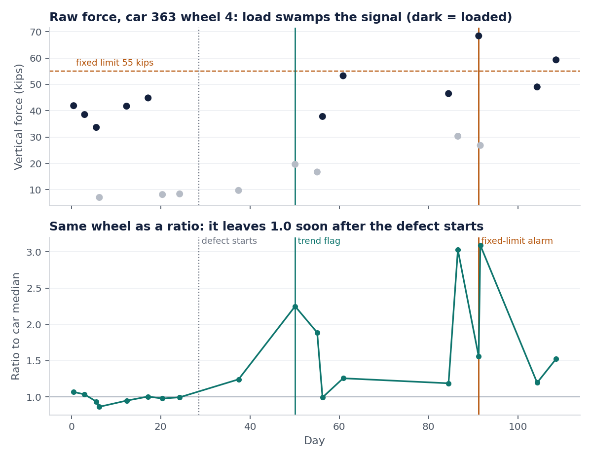
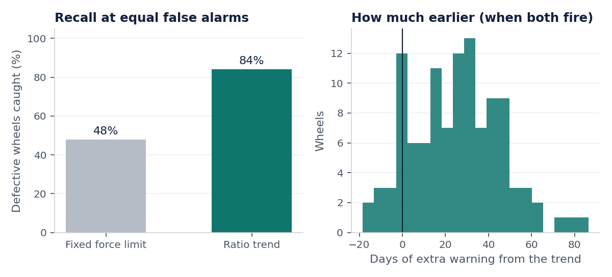
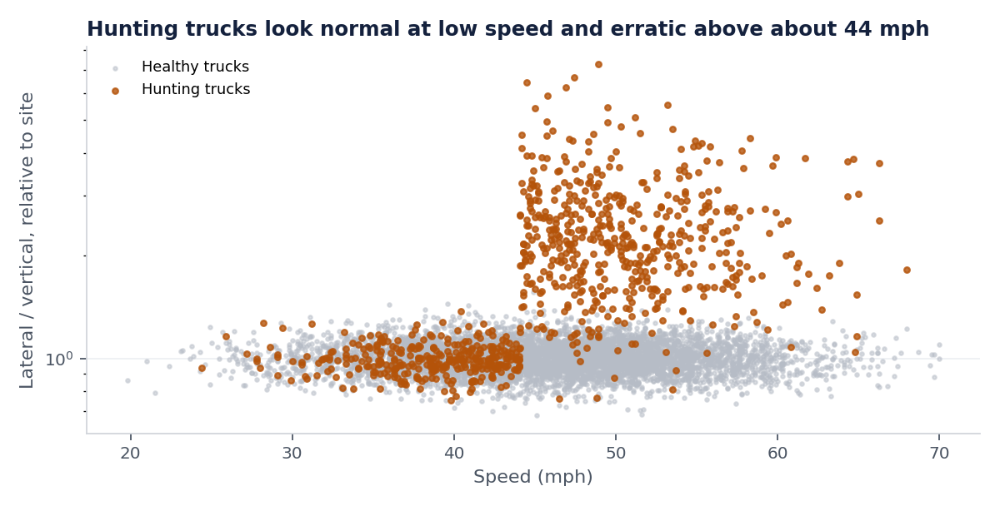
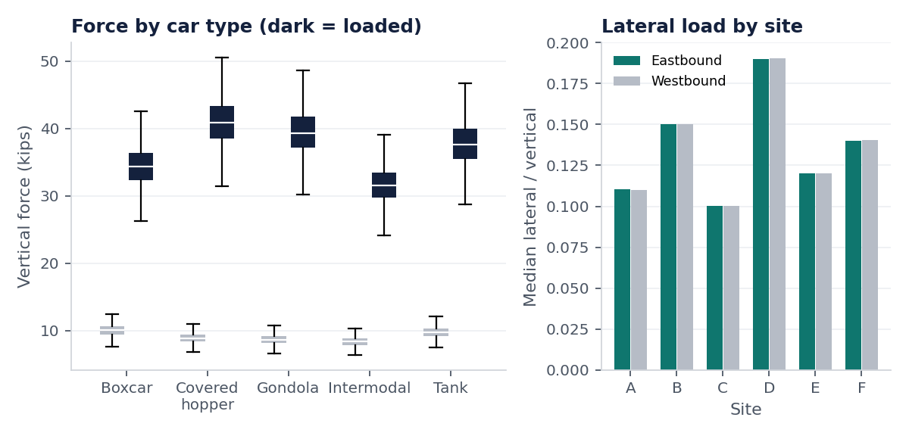

# Railcar Force Anomaly Detection

[](https://github.com/VishChalla/railcar-force-anomaly-detection/actions/workflows/ci.yml)


**Finding wheels and trucks that are starting to fail from wayside force-detector readings, weeks before a fixed force limit would raise an alarm.**

> **About the data.** My capstone at Michigan State (Aug to Dec 2025) was a predictive-maintenance project with MxV Rail, analysing 230,000+ railcar sensor readings from 6 track locations. That data, code and its findings are covered by an NDA and are **not** in this repository. This is an independent recreation of the *kind* of analysis, written from scratch on fully synthetic data that I generate here. Every number below comes from the simulator in this repo, not from MxV.



## The problem

Wayside detectors measure the vertical and lateral force of every wheel that rolls past. The obvious way to use them is a force limit: alarm when a wheel hits harder than X. The trouble is that raw force mostly measures things that are not faults:

- a loaded hopper hits the rail about five times harder than an empty one
- force rises with speed
- each detector site reads a little differently

So a limit low enough to catch a defect on an empty car floods you with false alarms from loaded ones. In the chart above, the top panel is one defective wheel's raw force: you cannot see the defect for the load. The bottom panel is the same wheel after normalisation.

## Approach

Three metrics that cancel out load, speed and site, then track how each component changes over time.

| Metric | Definition | What it catches |
|---|---|---|
| **Vertical ratio** | Wheel force divided by the median of the 8 wheels on the same car in the same pass | A wheel that hits harder than its neighbours, whatever the car weighs |
| **Ratio trend** | Least-squares slope of that ratio over the wheel's last 6 passes | A tread defect that is growing |
| **Lateral variability** | Standard deviation of a truck's lateral/vertical ratio over its last 6 passes, relative to its site | Truck hunting, which is erratic rather than consistently high |

A wheel is flagged when both its recent ratio and its trend are extreme by robust z-score (median and MAD, so the faults do not inflate their own threshold). All features use only current and past passes; a test confirms that removing future data changes nothing.

## Results

Simulated fleet: 1,500 cars, 12,000 wheels, 28,658 car passes over 120 days at 6 sites, **229,264 wheel readings**, with 240 wheel defects and 45 hunting trucks planted.

The baseline is a single force limit. To be fair to it, the limit is set as low as possible while raising **no more false alarms** than the ratio-trend method (11 healthy wheels). That is its best case.

| | Fixed force limit (55 kips) | Ratio trend |
|---|---|---|
| Defective wheels caught | 111 of 232 (48%) | **195 of 232 (84%)** |
| False alarms | 11 wheels | 11 wheels |
| Caught by this method only | 0 | **87** |

Where both methods fire on the same wheel, the trend fires first 84% of the time, with a **median of 27 days of extra warning**.



Truck hunting: all 45 planted trucks found, with 2 false flags out of 3,000 trucks. This one is easy in simulation because the planted instability is strong; I would expect real hunting to be much harder to separate.



Force patterns by car type, load state and site, which is what makes normalisation necessary:



## Run it

```bash
git clone https://github.com/VishChalla/railcar-force-anomaly-detection.git
cd railcar-force-anomaly-detection
pip install -e ".[dev]"
```

```bash
python -m railforce
```

```bash
pytest -q
```

The run takes about 5 seconds and writes `outputs/metrics.json`, `outputs/flagged_wheels.csv` and the figures in `docs/`.

## Limitations

- **The data is simulated**, with fault behaviour I chose. Real defects do not grow linearly, real sensors drop readings, and real fleets have maintenance events that reset a wheel. Results here show the method works on the problem as modelled, not how it would perform in the field.
- The ratio is sensitive to load: the same defect produces a larger ratio on an empty car than a loaded one, which is why the ratio is noisy from pass to pass. Modelling the impact as an additive force rather than a ratio would be the next refinement.
- If several wheels on one car are defective, the car median itself shifts and the ratio understates the problem.
- Thresholds are set from the population at the end of the period. A deployed version would fix them from a reference period.
- 37 observable defects were missed, mostly slow-growing ones seen only a few times after onset.

## Project layout

```
src/railforce/simulate.py   synthetic fleet, sites and planted faults
src/railforce/detect.py     ratio, trend and variability metrics; scoring
src/railforce/cli.py        run everything and draw the figures
tests/                      9 tests, including a no-future-leakage check
```

Built by [Vish Challa](https://github.com/VishChalla), MSc Supply Chain Management (Concordia) and BSc Computational Data Science (Michigan State).
